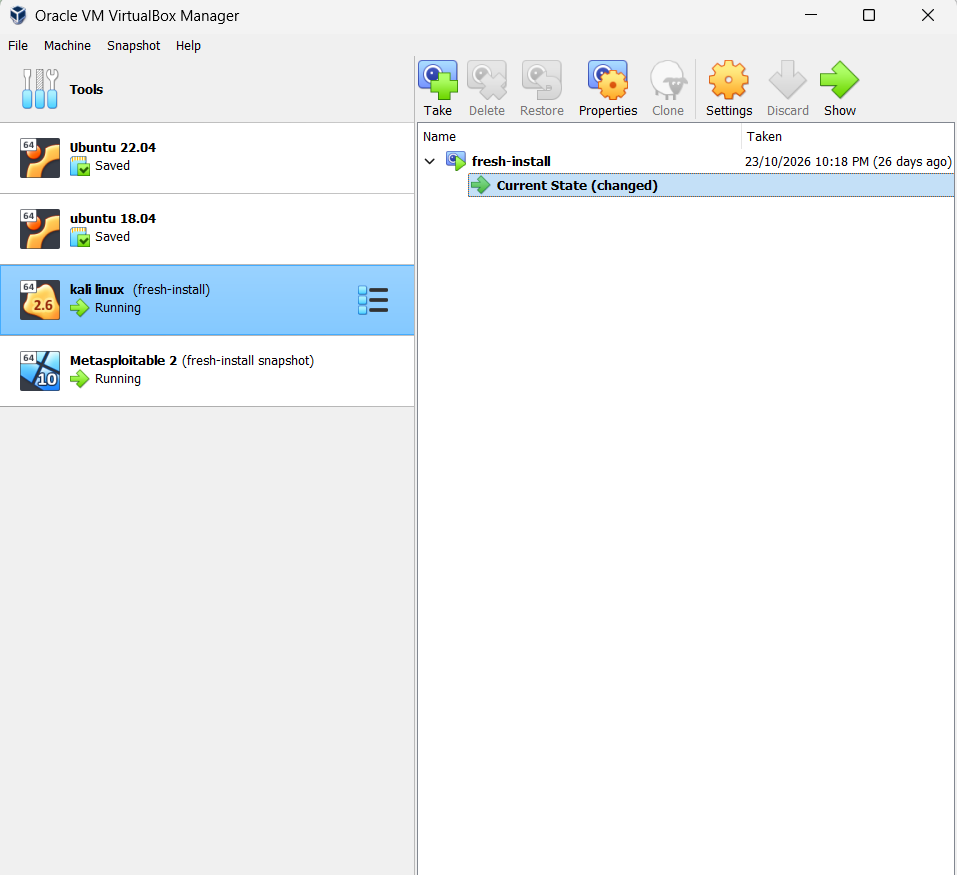
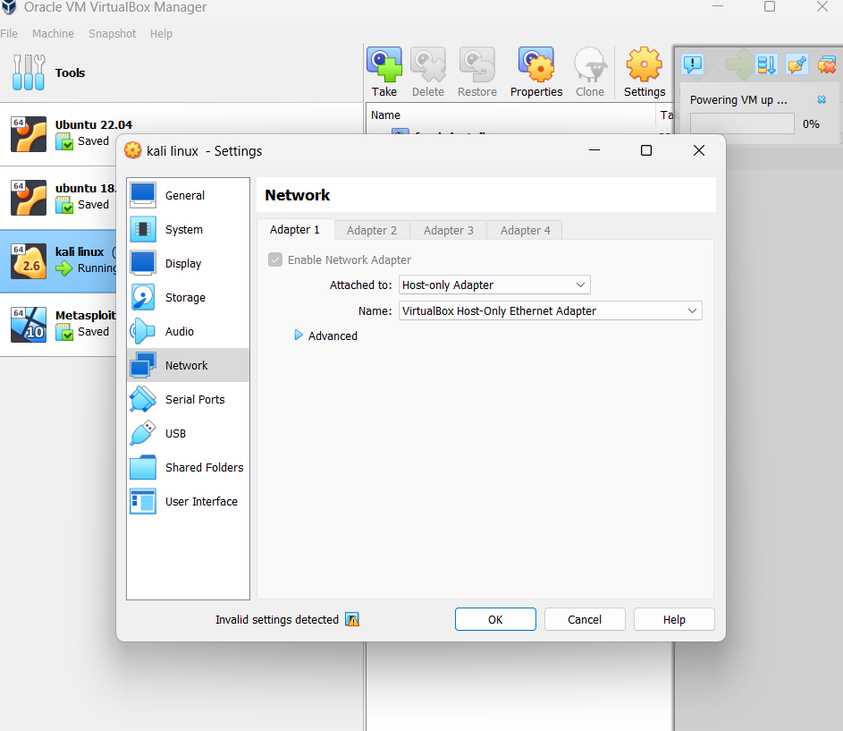
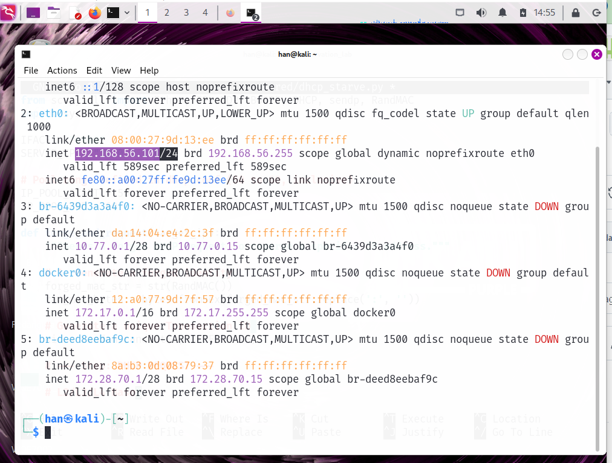
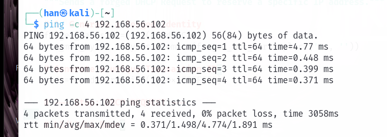

# Virtual Cybersecurity Lab Setup

## Project Overview

This project focuses on setting up an isolated virtual cybersecurity lab using Kali Linux and Metasploitable 2 in Oracle VirtualBox.

The purpose of this lab is to create a safe environment for practising cybersecurity techniques, including network connectivity testing, reconnaissance, and vulnerability assessment.

## Objective

- Set up Kali Linux as the security testing machine.
- Configure Metasploitable 2 as the vulnerable target machine.
- Establish network connectivity between both virtual machines.
- Prepare a controlled environment for future penetration testing activities.

## Environment and Tools

- Oracle VirtualBox
- Kali Linux
- Metasploitable 2
- Host-Only Network
- Linux Terminal

## Methodology

1. Installed Oracle VirtualBox on the host computer.
2. Imported and configured Kali Linux and Metasploitable 2 virtual machines.
3. Configured both machines to use a Host-Only network.
4. Started both virtual machines and checked their IP addresses.
5. Tested connectivity between Kali Linux and Metasploitable 2 using the ping command.
6. Verified that both machines could communicate within the isolated lab network.

## Results

The virtual lab was successfully configured, and network connectivity between Kali Linux and Metasploitable 2 was established.

The following IP addresses were used:

- Kali Linux: 192.168.56.101
- Metasploitable 2: 192.168.56.102

The successful connectivity test confirmed that the lab environment was ready for further cybersecurity exercises.

## Challenges and Improvements

One challenge during the setup was understanding the network configuration in VirtualBox and ensuring both machines could communicate.

This was addressed by checking the network adapter settings and verifying the IP addresses.

In the future, I plan to improve the lab by adding more virtual machines and exploring different network security configurations.

## Evidence

The following screenshots demonstrate the successful setup and configuration of my virtual cybersecurity lab.

### 1. VirtualBox Setup

This screenshot shows the Kali Linux and Metasploitable 2 virtual machines configured in Oracle VirtualBox.

### 2. Host-Only Network Configuration

This screenshot shows the Host-Only network configuration used to establish communication between both virtual machines.

### 3. Kali Linux IP Address

This screenshot shows the IP address assigned to the Kali Linux virtual machine.

### 4. Connectivity Test

This screenshot shows the successful ping test from Kali Linux to Metasploitable 2, confirming network connectivity.

## Ethical Considerations

All activities were performed in my own isolated virtual lab for educational purposes.
